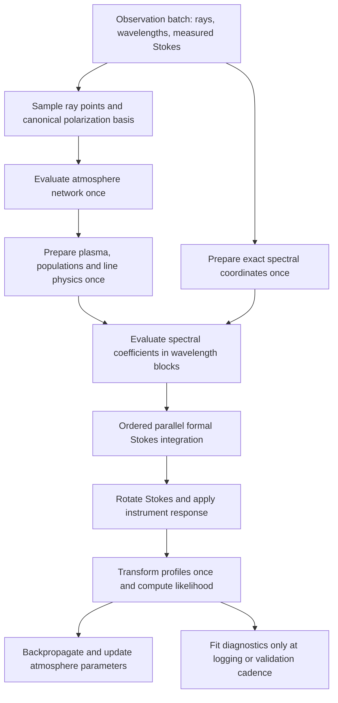

# PROM3THEUS architecture

**Physics-informed Reconstruction Of Magnetism in 3D THrough EUV and Spectropolarimetry**

[Documentation overview](README.md) · [Project README](../README.md)

`prom3theus` learns one atmosphere. Local LTE coefficients and differentiable
parallel formal Stokes integration map that atmosphere to instrument predictions.
Schema v5 contains no learned radiation field or transfer-residual objective.

## One inversion update

The production Stokes path has explicit stages with one owner for each stage:



| Stage | Component | Data lifetime |
| --- | --- | --- |
| Ray tracing and sampling | `LTEWindow.boundary_queries`, `sample_rays` | True shell intersections; stratified training jitter shared across all wavelengths; fixed endpoints and deterministic evaluation |
| Atmosphere | `LTEWindow.evaluate_atmosphere` | One batched network evaluation at all sampled points |
| Point physics | `LTELocalCoefficients.prepare_atmosphere`, `PolarizedLineOpacity.prepare` | One forward call; live tensors retain gradients |
| Spectral coordinates | `LTELocalCoefficients.prepare_spectrum` | Full query prepared once, then sliced into blocks |
| Spectral coefficients | `LTELocalCoefficients.evaluate_spectrum`, `PolarizedLineOpacity.evaluate_prepared` | Continuum and Voigt/Faraday profiles for one spectral block |
| Formal integration | `formal_stokes`, `affine_transfer_reduce` | Local propagators followed by an ordered balanced reduction |
| Detector response | `StokesObservationTerm.observe_stokes` | Emergent spectra rotated, calibrated and spectrally sampled |
| Likelihood | `StokesObjective.compare` and scoring methods | Transformed prediction/target and continuum weights reused |
| Training and reporting | `JointInversionModule`, `training.metrics` | Optimizer every update; detached fit diagnostics at log cadence |

`PreparedLTEAtmosphere` owns compact point state; `PreparedSpectrum` owns spectral
queries. Their axes remain separate. A per-ray grid broadcasts across depth and
uses gathers from each point's continuum table; it never replicates the entire
plasma state over wavelength. Field orientation, Doppler widths, damping, Zeeman
splitting and integrated line strengths are prepared once, before spectral
blocks. Prepared state is not cached across optimizer updates or detached.

The shipped inversion presets set `synthesis.windows[].jitter_fraction: 1.0`.
Interior points jitter independently between grid midpoints, with a small epsilon
margin to keep neighboring nodes separated. Both geometric shell endpoints remain
fixed. The formal solver receives actual line elements computed from these local
jitter offsets. Sampling is vectorized on the model device;
it needs no sorting, extra network pass or sequential depth loop. Owning model
`.eval()` disables jitter. Existing configurations that omit this option retain
uniform sampling. See [ray sampling details](parallel-formal-transfer.md).

Production Stokes arithmetic uses float32 throughout forward and backward.
`sample_shell_characteristic` retains local scene and ray offsets to compute
height and chart coordinates accurately; the network never recovers height by
subtracting the solar radius from a rounded global position. `CenteredWavelength`
likewise keeps small Doppler shifts separate from the absolute optical wavelength.
The fixed detector calibration is prepared once at higher precision on CPU.

`core.validation.deferred_validation` collects device-side validity flags at the
production prediction boundary. Nested numerical routines contribute flags and
the outer boundary transfers them together once per device. Public numerical
calls outside this context still validate immediately. Shape/type/index-safety
checks remain eager; invalid numerical inputs still raise an error before a
prediction is returned. This removes repeated validation waits inside spectral
blocks, not all CPU orchestration in training.

Training calls the lightweight scoring path between logging steps. Public
`evaluate_batches` retains full diagnostics by default for evaluation, artifacts
and standalone callers. Distributed diagnostics use valid sample counts; RMS
metrics combine squared values and maxima use a maximum reduction. The objective
already includes DDP normalization and is averaged across ranks only once.

The model is still an atmosphere network with optional physical constraints.
There is no radiation network, iterative LTE population solve, or sequential
layer-intensity recurrence. Wavelength blocks and the fixed algebraic polynomial
operations are implementation loops; the ordered depth reduction needs only
`ceil(log2(number_of_layers))` stages.

## Observation preprocessing

`preprocess.hmi` checks complete filename-matched Stokes sets and crops their
native detector pixels. Filter-response construction is a separate
`prepare hmi-responses` resource operation.

`preprocess.aia` scans FITS headers, caches the standard aiapy correction and
pointing tables, and dispatches independent read/calibrate/crop/write jobs.
Tables are loaded once and shared by the bounded worker pool. The image-store
adapter retains the uncertainty and line-of-sight arrays needed by the inversion;
SunPy coordinate construction is isolated in `instruments.aia_euv.geometry`.
Raw images are never accumulated across the time series. Reuse checks read
store metadata rather than loading all prepared image tensors.

## Dependency direction

```text
CLI -> application runners -> training/inversion
                              |-> radiative transfer
                              |-> observations
                              |-> instruments
                              `-> core geometry and neural models
```

Dependencies must point down this diagram.  In particular:

- `prom3theus.rt` does not import Lightning, Astropy, SunPy, Matplotlib,
  W&B, a data adapter, or the CLI.
- Observation readers produce canonical rasters and batches; they do not
  construct an inversion model.
- Instrument operators consume synthesized spectra; they do not know about
  optimizers or training loops.
- Export reconstructs the same forward model used during training.
- Network access is confined to explicit HMI/AIA acquisition and calibration
  commands. Runtime loading, synthesis, and diagnostics are offline.

## Package responsibilities

| Package | Owns | Does not own |
| --- | --- | --- |
| `core` | Coordinates, constants, neural primitives, solar kinematics | File formats, instruments, training |
| `config` | One strict schema-v5 scene/synthesis/stream configuration, environment expansion, path resolution | Component construction, defaults chosen by adapters |
| `resources` | The immutable legacy bundle, independently versioned optional scientific sets, and checksum validation | Downloads, runtime table generation |
| `resource_builder` | Flat common-atomic and per-instrument builders, pinned downloads, STiC/Wittmann generation, FTS extraction, and exact reproduction | Runtime imports, training-time generation |
| `rt` | Atmosphere contracts, unified plasma lookup, local polarized LTE coefficients, formal polarized transfer and characteristic geometry, generic optically thin quadrature | Observation I/O, instrument response, optimization |
| `observations` | Independent typed Stokes and scalar-image raster/batch contracts, safe sequence stores, data loading, shared scene metadata | FITS-specific calibration, synthesis |
| `instruments` | Independent Hinode, HMI, and AIA readers/preparation plus their response operators | Optimizers, loss scheduling, artifact policy |
| `download` | Independent observation-download workflows such as AIA time-series/calibration acquisition | Instrument-specific parsing, deployment dates/paths, training |
| `preprocess` | Reusable HMI/AIA preparation workflows, directory scanning, crop-aware reuse checks, and instrument API composition | Deployment paths, fixed crop settings, optimization |
| `application` | Run orchestration, typed configuration translation, stream/scene assembly, setup evaluation, and report scheduling | Numerical equations, optimizer internals |
| `inversion` | Scene LTE synthesis windows, stream likelihoods, shared objective reduction, physical constraints | Diagnostic rendering, schema translation, Lightning lifecycle |
| `training` | One stream training lifecycle and resumable reference-stream scheduling | Radiative-transfer equations, instrument parsing |
| `artifacts` | Atomic self-contained persistence and strict reconstruction/export | Observation preparation, training orchestration |
| `diagnostics` | Scientific convergence checks, and registered native-grid renderers | Production-run mutation |
| `validation` | Independent numerical transfer, comparison spectra, synthetic recovery, reference convergence | Production training or evaluation backends |
| `cli` | Argument parsing and lazy dispatch | Hidden scientific configuration |

HMI and AIA have independent download entry points. The HMI command calls its
instrument acquisition API directly; the AIA time-series workflow in
`prom3theus.download.aia` samples caller-supplied UTC targets and optionally
fetches its own calibration tables. It never imports HMI or scans HMI data.
The shell supplies event times, paths, channels, and tolerance. Independent
instrument preprocessors in `prom3theus.preprocess` receive all input/output
paths and crop settings from the caller. `scripts/sdo/prepare.sh` invokes
`prom3theus prepare hmi` and `prom3theus prepare aia`, keeping deployment
configuration in the shell and Python logic in the installed package. The
lower-level `prepare hmi-subframes`, `prepare hmi-responses`, and
`prepare aia-euv` commands remain available for individual preparation steps.
Runtime loading remains network-free.

Stored and synthesized Stokes profiles use fixed disk-center atlas-continuum
units. With `objective.continuum_normalization: true`, the Stokes objective
divides all four components of both profiles by the observation's
90th-percentile Stokes I across detector wavelengths. The quantile defaults to
`objective.continuum_quantile: 0.9`. Prediction and observation share the same
detached observed denominator, so prediction errors cannot change the scale. This
happens after the instrument response and before linear component scaling.
Shipped presets enable it. Omitted normalization remains disabled.

This continuum proxy can retain line absorption, especially for HMI; it is not
an independent line-free measurement. The loss retains sensitivity to predicted
brightness, so absolute continuum intensity still constrains temperature.
Nonpositive or nonfinite observed continua produce nonfinite losses; finite
nonpositive predictions remain penalized against a valid observation.
Loader data, physical forward synthesis, and raw residual metrics retain their
original units; loss-space diagnostic plots use the training transform.
Older artifacts with an explicit `continuum_floor` retain their original shared,
detached observed-mean normalization for reproducible evaluation.

Maintained Stokes presets use `mse` with `stokes_scales` of I=1 and Q/U/V=0.1.
After continuum normalization, both profiles are divided by those component
scales before subtraction. Separate component weights are one, so Q/U/V
squared residuals receive a factor of 100 relative to unscaled residuals.
Training, comparison plots and artifact metadata share this same transform.
The scales are configuration-derived buffers and cannot overwrite new settings
when a training checkpoint resumes. Legacy `asinh_mse`
keeps I linear and stretches Q/U/V before subtraction, after any continuum
normalization. Component weights multiply mean squared residuals directly,
without normalizing their sum. Per-profile continuum normalization removes absolute
brightness; it is not a noise-weighted likelihood.

The maintained presets use SIREN coordinate networks with width 256 and eight
hidden layers. Schema defaults set the first sine frequency to 30 and hidden
frequencies to 1; radial weighting is explicitly disabled. They use normalized
local spatial coordinates, plus time for dynamic runs, without a separate
positional encoder. Isotropic-feature MLPs remain supported for existing models
and explicit custom configurations. Switching architectures requires a fresh
training run and output directory; observation stores can be reused.

## Formal LTE transfer and ownership

`LTEWindow` owns local atomic physics and numerical integration controls for a
spectral window. `JointForwardModel` registers windows once; observation terms
keep non-owning references. Only atmosphere and calibration parameters are
trained. `LTELocalCoefficients` supplies dimensional K and normalized Planck
sources independently at every ray node.

`rt.formal_transfer` computes frozen midpoint layer attenuation in parallel,
then composes ordered affine maps in a balanced tree. For adjacent near/far
layers, `(A,b) = (A_near A_far, b_near + A_near b_far)`. Associativity permits
O(log depth) stages without assuming commuting propagation matrices. The
reduction works relative to the bottom intensity to preserve constant thermal
equilibrium. Standard tensor operations support first and higher derivatives.
Float64 transfer arithmetic is the default; outputs retain the coefficient dtype.

Every observed characteristic reaches the true lower shell boundary. The bottom
source is the modeled local Planck function, or a configured fixed incoming
temperature. Uniform distance nodes include both boundaries. Lower-boundary
optical thickness and depth convergence remain scientific validation requirements.
AIA keeps its independent optically thin quadrature.

Each ray uses a nonsingular canonical polarization basis constant along its
length; detector projection handles the spin-two rotation. There is no trained
angular support cone. Geometry rejects grazing rays without lower-boundary
intersection and characteristics outside the configured lateral halo. Spectral
queries must remain inside the configured vacuum window after detector shifts.

Learning-rate decay uses `training.learning_rate_decay_steps`, or the estimated
run length (10000 updates for unbounded runs). All trainable parameters optimize
from the first step; the data loss differentiates through formal integration.

Spatial names spell out `megameter` throughout configuration, Python APIs,
serialized metadata, and plot labels (one megameter is 1,000,000 metres).
For example, use `lateral_halo_megameter`, `shell_height_bounds_megameter`,
and `spatial_coordinate_scale_megameter`. Values and conversions are unchanged.
The abbreviated field names are not retained as compatibility aliases; external
configurations and consumers must adopt the new names. Existing checkpoints and
prepared metadata containing the old names must be regenerated.

Wavelengths are vacuum Angstrom in one inertial frame. Local material velocities
include the Carrington rotation contribution; spacecraft motion, removed
registration shifts and bounded instrument offsets map detector wavelengths to
field queries. The source uses the line-shift-only moving-medium approximation.
Transfer is quasi-static, and total continuum extinction uses the named
`thermalized_continuum` approximation. Physical scattering redistribution and
non-LTE populations require a different coupled equation.

The retained numerical solvers are explicitly imported from
`validation.reference_synthesis`, `validation.reference_transfer` and
`validation.reference_forward` for comparison and MURaM fixture generation.
Production `rt`, inversion, training, components and artifact reconstruction do
not import those solvers. No legacy aliases remain in the public runtime.

MHS closure and local LTE coefficients use the same `SolarPlasmaTable` physics. Its
thermodynamic branch matches the bundled STiC state in the photosphere,
continues through a reduced CHIANTI default-coronal-equilibrium electron
mapping, and transitions to the fully ionized ideal STiC mixture. The CHIANTI
resource stores electrons per H; all thermodynamic outputs are reconstructed
from one shared hydrogen density. Native CHIANTI values remain exact through
10 MK, followed by a C1 log-temperature blend over 10--20 MK; the ideal fully
ionized limit is exact at and above 20 MK. Outside either STiC pressure edge,
the thermodynamic composition continuation recovers asymptotically linear
pressure scaling without permitting excess charge or negative heavy-particle
counts.

The radiative branch reproduces STiC exactly through 10 kK. From 10 kK to
31.6 kK, neutral-H, Fe I, and true continuum absorption fade to zero with a C1
quintic window. Scattering transitions over the same interval to Thomson
extinction, `n_e sigma_T`, and remains positive in the corona. Pressure tails
scale populations and scattering with the hybrid-EoS density ratio and true
absorption with its square.

The primary atmosphere decodes temperature, gas pressure, and microturbulence
as unbounded linear residuals in natural-log space around the radial reference.
All consumers use those actual positive values: there is no endpoint clipping,
finite table-support penalty, or separate effective LTE state. Planck emission,
thermal broadening, and damping therefore also retain gradients to the model
outputs throughout the domain.

The radial reference deliberately separates the line-formation grid from its
upper thermodynamic support. Its established 25-point FALC_82 mapping over
`-5 <= log10(tau500) <= 1` remains unchanged for LTE rays. The physical-height
reference additionally restores the 37 native FALC nodes at
`log10(tau500) < -5`, ending at 2.073502459 megameter with `T = 100 kK` and
`p = 0.0319344213 Pa`. From that native top, a quintic smootherstep in
`log(T)` reaches the configured 1 MK value at 2.5 megameter, after which the reference
is isothermal. Pressure is continued hydrostatically through the full domain
with inverse-square gravity and the thermodynamic branch of `SolarPlasmaTable`.

Maintained magnetofluid runs use a Cartesian vector-potential parameterization:
the three magnetic network channels are `A` in G m, and the exposed magnetic
field is `B = curl(A)` in G. This makes `div B` identically zero; an enabled
`magnetic_divergence` entry reports that exact zero without constructing a
redundant magnetic Jacobian. `A` itself is determined only up to a gauge, so
the `vector_potential_gauge` equation penalizes `div A` on the ordinary volume
collocation points: that divergence is the trace of the same Jacobian the curl
already builds, so the gauge is fixed with no additional samples, network
evaluations, or derivative graph. It is normalized by the local field scale
exactly like the other magnetic residuals. Direct Cartesian `B` decoding remains available
as an explicit current atmospheric representation. Dynamic runs
use the ideal induction equation, momentum, logarithmic continuity
`D ln(rho)/Dt + div(v) = 0`, and the vector-potential magnetic field. The maintained dynamic HMI run additionally applies a
volume current-free (`curl B = 0`) initialization for its first 5,000 optimizer
steps, then removes that term with a hard cutoff so the ideal-MHD solution can
develop currents. It has no resistive term and disables both the soft
adiabatic-pressure residual and the radial magnetic-energy-gradient heuristic.
No explicit energy equation is currently solved.

Physics residuals use characteristic scales evaluated independently at each
sampled height. Transport equations use the combined rate
`1/T + V0/L`. Induction uses the denominator `B_* (1/T + V0/L)`;
logarithmic continuity is a specific rate and divides directly by
`1/T + V0/L`. Direct-`B` `div B` uses `B_*/L`; vector-potential `div B` is exact
zero. Magnetic boundary residuals use a detached
point-local `sqrt(B^2 + B_floor^2) / L` scale. Every
characteristic scale is formed separately at each sampled height and detached
before it divides a residual; magnetic relative scales additionally use the
configured physical floor. The predicted fields and every derivative in the
residual numerator remain attached to autograd. This prevents an equation from
reducing its gradient by changing its own denominator. Vector residuals are
averaged over components rather than summed.

There is no potential- or NLFFF-volume target. At the outer surface, the normal
derivative of the tangential magnetic field is driven to zero while the normal
field remains free. The
`upper_boundary_open_velocity` loss supplies a transmissive velocity boundary:
the normal derivative of every Cartesian velocity component,
`(r_hat dot grad) v`, is driven to zero using the detached `V0/L` scale. It
permits either sign of radial flow and does not create the systematic outward
bias of a one-sided no-inflow penalty.

The dynamic HMI run also draws independent random points on all four angular
side faces with equal face counts. It drives the normal derivative of velocity
and the tangential projection of the magnetic normal derivative to zero. The
top and side magnetic Neumann losses apply at their configured weights from the
first step. Magnetic flux itself remains free to cross every face; side samples
have no shared-height grouping or group-derived normalization. The separate
volume current-free initialization remains a finite-step disambiguation aid.

HMI preparation writes an exact detector cutout and performs no numerical
padding. The physics angular domain is formed from the extrema of valid surface
pixels over all selected acquisitions. A padded FOV therefore means only that
the chosen 1024 by 512 cutout contains contextual margin around the region of
scientific interest; the runtime does not know a separate inner science FOV.

Because the energy equation is disabled, the spectrally invisible upper
temperature would otherwise be underdetermined. A weak upper-volume prior keeps
`log(T)` near the fixed hydrostatic-coronal reference and therefore acts as an
explicit prescribed-temperature stabilization, not as an energy law. A
separate top-surface prior fixes `log(p)` to the reference external pressure.
The model temperature and pressure are attached; both reference targets are
fixed and detached. These two conditions are temporary thermodynamic closure
and boundary data until a complete energy treatment is introduced.

The optional full-volume radial magnetic-energy-gradient loss evaluates
`d(B^2)/dr = 2 B dot dB/dr` from the Cartesian magnetic Jacobian. After
averaging that derivative over each height group and normalizing by the detached
height-group mean `B^2/L`, with the squared magnetic floor applied, it penalizes
only a positive layer-mean gradient. Local energy may increase as a flux system
expands laterally, while layer energy that is constant or decreases outward
receives exactly zero penalty. The term is a soft monotonicity preference rather
than a top-field target, and it is disabled in the maintained dynamic HMI run.

Absolute Doppler shifts have an unavoidable gauge freedom: a common velocity
along the observer LOS and an instrumental wavelength offset produce the same
line displacement. Maintained dynamic runs therefore optimize one explicit
positive-redshift LOS correction after projecting into the Stokes basis. There
is no separate penalty forcing the mean co-rotating atmospheric LOS velocity to
zero; its split from the instrumental offset is therefore determined jointly by
the Stokes fit and active physical equations. The correction does not change the
radial or transverse physical fields used by momentum, induction, and
continuity. Static inversions leave it disabled.

A future non-LTE or physically scattering model must explicitly add population
and angular coupling equations, new boundary data and a new artifact contract;
there is no dormant numerical-backend switch in the current implementation.

## Observation and instrument boundary

Hinode/SOT-SP and SDO/HMI are independent adapters. Both produce the same
canonical observation model, but neither inherits implementation details from
the other.  Instrument-specific response tensors travel in the batch under an
explicit response mapping.

The maintained Hinode adapter accepts exactly one flat, prepared raster and
constructs a static three-coordinate atmosphere. Nested raster sequences and
time-range selection are rejected. The HMI adapter retains its independent
time-dependent acquisition path.

Schema version 5 retains the independent scalar-image contract rather than
encoding EUV intensities as synthetic Stokes data. Each prepared AIA channel
keeps its native registered grid, actual TAI exposure time, surface anchor,
observer-to-Sun ray, uncertainty, valid mask, and calibration identity. A
`SceneContract` is the only bridge between those physical records and the
shared atmosphere coordinates; AIA is never reprojected onto HMI pixels.

The AIA term evaluates the same atmosphere's unrestricted temperature and gas
pressure along each native ray. The shared thermodynamic EOS supplies electron
density and the independently packaged response supplies `K_c(T)`, giving
`I_c = 10^-10 integral n_e^2 K_c(T) ds_m`. The v1 response is total-only at its
declared reference density. It smoothly tapers to zero at the 10 kK and 1 GK
edges and is exactly zero beyond them; only the observation response is tapered,
not the atmosphere. An identifiable common/relative log-gain model accounts for
residual calibration error without introducing an AIA-only density field.

`JointForwardModel` owns one atmosphere, LTE windows, observation terms and
shared objectives. Shared atmospheric physics runs once per optimizer step.
Terms own calibration state and expose canonical-batch predictions. Metrics use
stream-qualified names. Atmosphere gradient balancing is available because
Stokes likelihoods now act directly on atmospheric parameters.

There is no RT collocation objective or radiation certification stage. A zero
stream weight disables that likelihood during training while retaining it for
validation. Versioned checkpoint contracts reject the previous learned-RT model.

Training logs the total loss plus its active weighted contributions: observation
`data_loss`, enabled physics/regularization components, and enabled calibration
priors. Disabled terms and expired scheduled losses create no series. An active
loss remains visible even when its value is exactly zero. Stokes training and
validation both log component MSE in objective units and raw per-component
residual RMS; validation also logs outgoing admissibility. Validation `data_loss`
is unweighted, with AIA asinh RMSE reported separately. Render-only streams remain
available for validation. Fixed LOS corrections and disabled Q/U warmup create
no series; fitted corrections are logged only during training. All supplied runs
disable Q/U warmup. Optimizer metrics contain one shared learning rate, with no
gradient-norm or clipping-factor series. Optional loss-balancing diagnostics are
retained. AIA channel losses and gains stay in local reports.
AIA plots from all configured observations share two stable media galleries:
`AIA observation comparison` and `AIA side view`. Optional contribution
plots remain local;
Stokes and atmosphere plots retain the renderer titles, such as
`Stokes comparison`, `Magnetic field`, and `Optical depth`;
filenames and step numbers never create dashboard keys. There is no `streams/`
image logging namespace;
step-specific directories retain local history. Gradient-finiteness checks remain
active without logging gradient extrema.

`diagnostics.providers` registers rendering callbacks by term type. Setup and training
collect returned artifact records and sends them to logging from `DiagnosticOutput(report, paths)` without scanning report text or guessing
filenames. The built-in renderers retain bounded native-grid evaluation and
per-stream names. Validation preserves model mode and RNG. Diagnostic pixels
are a subset of inversion data, not a held-out training split.

## Sampling

`training.streams.StreamBatchScheduler` uses `training.reference_stream` (or the
scene reference when omitted) to define epochs. All configured streams supply
one batch per step. Other streams continue independent passes across reference
epochs. Loader cursors and CPU sampling RNG states are saved in `last.ckpt`.
Restoration replays delivered batches within the current pass; this costs reads
but avoids storing an entire global permutation in the checkpoint. Built-in
prepared-data reads are deterministic. A new stochastic data provider must
supply equivalent reproducible behavior; arbitrary external mutable loaders
cannot promise exact replay. Worker counts do not change the outer scheduler,
which runs in one process.

`LTEWindow` evaluates jittered coarse ray-distance nodes. Optional
`coarse_to_fine` adds contribution-guided fine points using the shared depth
sampler: 32 coarse plus 32 fine in the Hinode Stokes-only preset. Coarse
coefficients are reused, fine points receive a second batched network evaluation,
and the sorted merged distances define the integration intervals. Both sets
retain atmosphere gradients; proposal locations are detached. `depth_count`
controls the coarse count; `wavelength_chunk_size` controls block size, not
spectral resolution. All layer coefficients and affine-map pairings within a
reduction stage are batched. No serial intensity loop remains in production.

`inversion.depth_sampling` continues to provide bounded jitter, contribution-weighted
inverse-CDF sampling and merging for Stokes and AIA's optically thin emission integrals.
Coarse and fine atmospheric evaluations retain gradients; proposal locations are detached. AIA
keeps float64 shell geometry and fixed photospheric/outer-shell endpoints.
Training jitters interior coarse points independently per AIA ray and selects one
random quantile per fine-sampling stratum; validation and export use deterministic
coarse points and midpoint fine quantiles. `DepthRefinement` lives beside the
common sampling functions; AIA has no dependency on the reference Stokes solver. The maintained
AIA configuration uses 96 coarse plus 96 fine samples. Adaptive trapezoidal
quadrature is not guaranteed to outperform a fixed grid for every profile;
dense-reference convergence checks remain necessary.

`rt.optically_thin.trapezoid_weights` computes nodal line elements from the
**final sorted ray distances**, after both perturbation and refinement. For
intervals `ds[i] = s[i+1] - s[i]`, endpoint weights are half their adjacent
interval and interior weights are `(ds[i-1] + ds[i]) / 2`. Integration and
contribution diagnostics use this same helper. Distances stay float64 until
line elements are formed, preventing nearby refined samples from collapsing
when fields are float32. AIA rays are normalized and their shell intersections
use a rationalized root to avoid cancellation near the photosphere. The weights
sum to the physical LOS length, which differs from radial height off disk centre;
no importance-probability correction or second coarse integral is added.
`RayIntegralResult.line_element_m` exposes these weights for auditing.

## Persistence

`output_directory/state.p3s` and `output_directory/last.ckpt` are rolling files,
with no intermediate checkpoint directories or numbered versions. Plots,
validation metrics, caches and logger working files go under `work_directory`.

`artifacts.checkpoint` owns one tensor-only evaluation format. Its context
contains atmosphere/synthesis/term constructor options, the common scene,
spectral bounds, fixed physical scales, resource identities,
observation references and resolved configuration. It stores all model/term
parameters and buffers needed for evaluation and no optimizer or observation
pixel arrays. `P3SLoader` reconstructs an `EvaluationModel` independently of
training, verifies resource/tensor contracts, and exposes per-stream prediction
and shared-field queries. Observation stores are accessed lazily for raster
comparison/export. `--stream` selects the stream for raster-based CLI exports.
Atmosphere exports keep physical Carrington and inertial velocity vectors;
observer/registration and calibration shifts are exported as separate scalars
and `detector_to_inertial_wavelength_factor`, never as modified material vectors.
The full checkpoint additionally holds optimizer/scheduler state and sampling
progress for continuation. Old formats are rejected, not migrated. Within the
current formal-LTE format, float64 fixed buffers from earlier snapshots may be
converted to the float32 runtime. Tensor names, shapes, learned-parameter dtypes,
and all other dtype changes remain strict; archived files are not rewritten.

The component-extension test registers a third temperature-observation type,
parses its configuration, differentiates its likelihood through the common
atmosphere, saves it, reconstructs it, and predicts through the public loader.
It also runs through the common optimizer using a non-raster observation provider.
This verifies the extension seam independently of HMI/AIA construction.


### Persistent training tensors

`TensorDiskDataset` is the common batch-indexed dataset for final training
values. `TensorDiskDataset.create(tensors, directory, batch_size, seed=0)` accepts
a dictionary (including nested dictionaries) of tensors with the same leading
sample dimension. It applies one shared global permutation and writes one NPY
file per tensor. Reopen it with `TensorDiskDataset(directory, batch_size)`;
`dataset[i]` reads the contiguous i-th batch, including a partial final batch.
The dataset retains paths and small manifest metadata only. Returned batches
own their storage; file mappings are closed after each read.

Training preparation uses the same implementation's `from_batches` path to
stream native observations into the final shuffled files without allocating
a second full training corpus in RAM. `PersistentTensorLoader` persists
channel pools under `work_directory/training-tensors/<stream>`, then releases
its native dataset references. It randomizes chunk IDs with the existing
seeded, resumable schedule. A matching source/configuration/implementation
identity reuses the files on restart. Preparation adapters remain separate
for scene setup and raster diagnostics.


Resume compatibility compares observation identity and persistent model/reference
structure. Fitting controls such as loss weights, objective settings, potential
weight schedules, per-step collocation counts, and loader batch sizes may change.
New loss buffers and learning-rate settings take precedence over saved values;
learned parameters and optimizer history are restored. Changing batch size
restarts data coverage using the new chunk boundaries while retaining the
optimizer step. Data, network architecture, and potential reference-grid changes
remain checked; mismatch errors report the differing contract paths.
